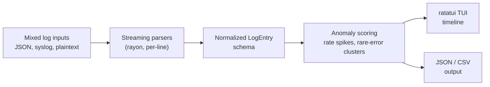

# logsculpt

**Merge mixed-format logs into one coherent timeline, in seconds, before the incident review even starts.**

[](https://github.com/SlateGitOrg/logsculpt/actions/workflows/ci.yml)

## Why

When something breaks in production, the first 20 minutes of an incident are almost never spent thinking — they're spent grepping. One service logs JSON, another logs BSD syslog, a third writes plaintext to a file some contractor wired up in 2019 with its own timestamp format. Before an on-call engineer can even see *what happened, in what order, across which services*, they're tailing four terminals, eyeballing clocks, and squinting for the one weird error buried in ten thousand ordinary ones.

logsculpt exists to collapse that setup time to zero: point it at your logs, and it gives you one normalized, chronologically-merged timeline with statistically-flagged anomalies already highlighted — either in an interactive terminal UI you can scroll through live, or as clean JSON/CSV for piping into whatever you already use.

## Architecture



1. **Parsing.** Each input line is sniffed and routed to one of three parsers: a JSON-lines parser (tolerant of `timestamp`/`ts`/`@timestamp`, `level`/`severity`, `message`/`msg`, and friends), a syslog parser covering both RFC 3164 (legacy BSD) and RFC 5424 (structured-data), and a heuristic plaintext parser that regex-scans for embedded timestamps (ISO8601, Apache CLF, slash-dates) and severity keywords when a line matches neither format. Parsing is embarrassingly parallel — lines are split across threads with `rayon`, since each line's parse is independent of every other.
2. **Normalization.** Every parser emits the same `LogEntry` schema (timestamp in epoch-ms, severity, host, service, message, source format, structured extra fields), so streams from wildly different services become directly comparable and mergeable — sorted once into a single timeline.
3. **Anomaly scoring**, with no external ML dependency:
   - **Rate spikes**: the timeline is bucketed into fixed windows; buckets whose event count is a z-score outlier relative to the rest of the stream get flagged. Good for "this service suddenly started logging 50x its normal volume."
   - **Rare-error clustering**: error/critical messages are fingerprinted (numbers, UUIDs, and quoted values collapsed to placeholders), then fingerprints that are *globally rare* but *burst within a short window* are flagged. This catches a genuinely new failure mode even when overall error volume looks normal — something a pure rate-spike detector would miss entirely.
4. **Output.** Either drop into the `ratatui` TUI to scroll the live-annotated timeline interactively (⚠ markers on anomalous rows, severity-colored text, jump-to-next-anomaly), or run non-interactively with `--format json`/`--format csv` for piping into `jq`, a spreadsheet, or your existing tooling.

## Quick start

Prerequisites: a stable Rust toolchain and `jq` for the examples below.

```bash
# Build
cargo build --release

# Try it on the bundled fixture (no TUI, JSON out)
./target/release/logsculpt tests/fixtures/mixed.log --format json | head -2

# Merge and view interactively (arrow keys / j,k to scroll, n = next anomaly, q to quit)
./target/release/logsculpt service-a.log service-b.log /var/log/syslog

# Or pipe a normalized, anomaly-annotated timeline out as JSON
./target/release/logsculpt service-a.log service-b.log --format json | jq 'select(.is_rare_error_cluster)'

# CSV for spreadsheets / awk
./target/release/logsculpt app.log --format csv > timeline.csv

# Read from stdin
tail -f app.log | ./target/release/logsculpt - --format json
```

Tune the detectors from the CLI:

```bash
./target/release/logsculpt *.log --format json \
  --bucket-ms 5000 --z-threshold 2.5 --min-spike-count 10 \
  --cluster-window-ms 30000 --rare-ratio 0.03 --min-cluster-size 4
```

## Example

`tests/fixtures/incident.log` is 120 normal requests, 120 routine `cache miss` errors and a burst of five new `payment gateway refused card` errors:

```bash
./target/release/logsculpt tests/fixtures/incident.log --format json \
  | jq -c 'select(.is_rare_error_cluster) | {timestamp, severity, message}'
```

```json
{"timestamp":"2024-03-15T10:05:30+00:00","severity":"ERROR","message":"2024-03-15 10:05:30 ERROR api: payment gateway refused card 1000"}
{"timestamp":"2024-03-15T10:05:31+00:00","severity":"ERROR","message":"2024-03-15 10:05:31 ERROR api: payment gateway refused card 1001"}
...
```

The cache-miss errors are common, so they are not flagged; only the new failure mode is.

## Supported log formats

| Format | Example |
|---|---|
| JSON lines | `{"timestamp":"2024-03-15T10:23:45Z","level":"error","message":"db timeout","service":"orders-api"}` |
| Syslog RFC 3164 | `<34>Oct 11 22:14:15 mymachine su: 'su root' failed for lonvick` |
| Syslog RFC 5424 | `<165>1 2003-10-11T22:14:15.003Z myhost app - ID47 [ex@32473 x="1"] event log entry` |
| Plaintext (heuristic) | `[2024-01-15 10:23:45] ERROR payment-service: card declined` |

Format detection is automatic and per-line, so a single file (or a single merged run across many files) can mix all three without any configuration.

## Project layout

```
src/
  schema.rs        common LogEntry / Severity / SourceFormat types
  time_util.rs      timestamp parsing helpers (RFC3339, RFC3164, CLF, heuristics)
  parsers/
    json_parser.rs      JSON-lines parser
    syslog_parser.rs     RFC3164 + RFC5424 syslog parser
    plaintext_parser.rs  heuristic timestamp/severity extraction
    mod.rs               format sniffing + parallel dispatch
  ingest.rs         file/stdin reading, multi-source parse + merge
  anomaly.rs        rate-spike + rare-error-cluster detection
  output.rs         json/csv writers with anomaly annotation
  tui.rs            ratatui interactive timeline viewer
  main.rs           CLI (clap)
benches/
  throughput.rs     criterion benchmarks: sequential vs. rayon-parallel parsing,
                    plus anomaly-detection cost, at increasing corpus sizes
tests/
  cli_integration.rs      end-to-end tests against the built binary
  property_parsers.rs     proptest property tests for all three parsers
  fixtures/               sample mixed-format log fixtures
```

## Testing

```bash
cargo test              # unit + integration + property tests (offline, no network/Docker required)
cargo bench --bench throughput -- --test   # smoke-test the benchmark harness (fast, single iteration)
cargo bench --bench throughput             # full statistical benchmark run (see target/criterion/report)
```

The test suite is fully offline: parser correctness (unit + `proptest` property tests generating randomized valid/invalid inputs), anomaly-detection correctness on constructed timelines, and full CLI round-trips (`assert_cmd`) against fixture files and synthetically-generated temp logs. Nothing requires network access, Docker, or a running cluster.

## Benchmarks

`benches/throughput.rs` synthesizes a mixed JSON/syslog/plaintext corpus at increasing sizes (10K/100K/500K lines) and benchmarks sequential vs. `rayon`-parallel parsing, plus the cost of anomaly detection over already-parsed timelines. Parsing scales near-linearly with core count since each line's parse is independent; run `cargo bench` locally (ideally on a multi-core machine) to see the speedup and generate an HTML report under `target/criterion/report/index.html`. For true multi-GB stress testing, concatenate the corpus generator's output to disk (or point logsculpt at real rotated log archives) and time `logsculpt *.log --format json > /dev/null`.

## Docker

```bash
docker build -t logsculpt .
docker run --rm -i logsculpt - --format json < app.log
```

(The interactive TUI needs a real TTY — run with `docker run -it` and mount your logs as a volume instead of piping via stdin.)

## Limitations

- Anomaly detection is statistical (z-score buckets and fingerprint rarity), not a trained model; thresholds are tunable but not adaptive.
- Plaintext parsing is heuristic and can misread timestamps in unusual formats; lines with no recognizable timestamp fall back to a caller-supplied default.
- The whole input is held in memory to build the merged timeline.

## License

MIT — see [LICENSE](LICENSE).
